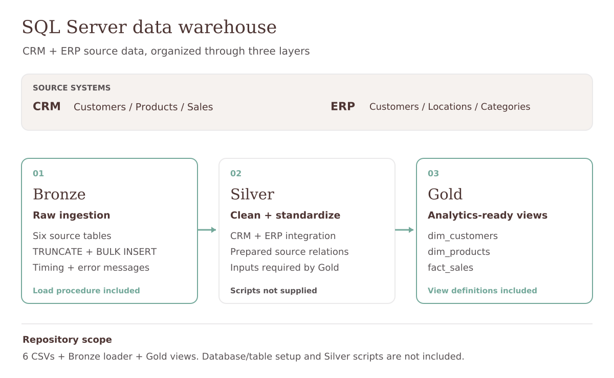
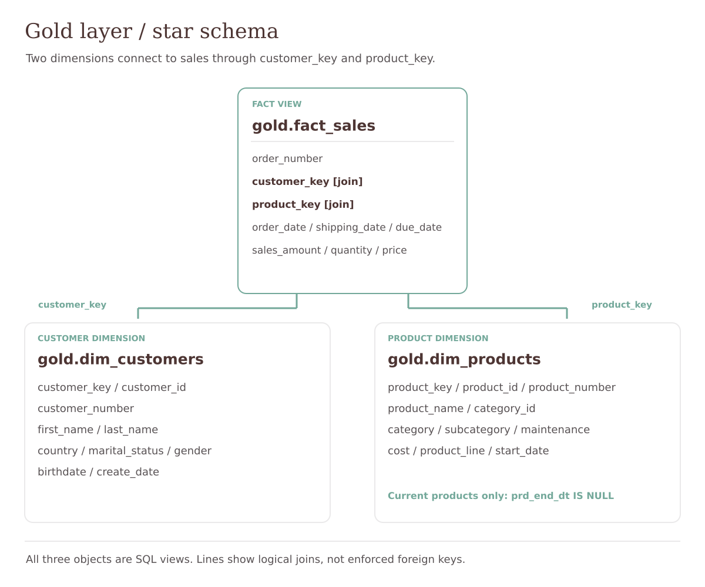
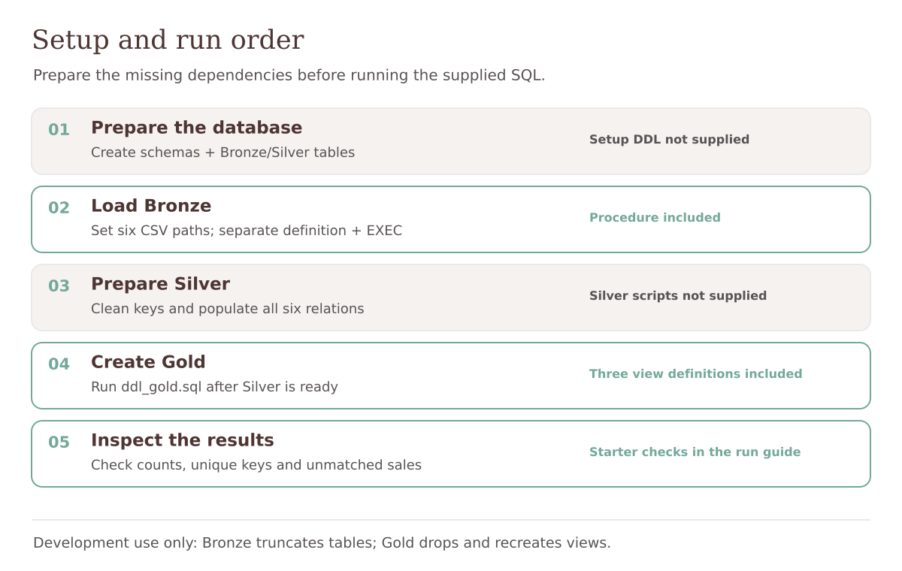

# SQL Data Warehouse Project

A SQL Server training project that brings CRM and ERP sales data into a medallion architecture: raw files in **Bronze**, prepared data in **Silver**, and customer, product and sales views in a **Gold star schema**.

Built together with [Thouseef](https://github.com/thousifva) during training. This repository presents my supplied project files, with new diagrams and documentation based on their actual contents.

[Architecture](#data-architecture) · [Star schema](#data-model-star-schema) · [Setup](#setup-and-run-order) · [Data catalog](docs/data-catalog.md) · [Run guide](docs/run-guide.md)

## About this project

The source systems cover different parts of the same business: CRM supplies customers, products and sales, while ERP supplies customer demographics, locations and product categories. The warehouse design joins those sources into one model for analysis.

**Flow:** CRM + ERP CSVs → Bronze ingestion → Silver preparation → Gold star schema → SQL reporting

| Layer | What happens | Included in this snapshot |
| :--- | :--- | :--- |
| Bronze | Six raw tables receive a full CSV refresh with `TRUNCATE TABLE` and `BULK INSERT` | Original loading procedure |
| Silver | Source relations are prepared for the joins and business columns used by Gold | Scripts not supplied |
| Gold | Two dimension views and one sales fact view expose reporting-ready columns | Original view definitions |

> **Repository scope:** six source CSVs, the Bronze load procedure and the Gold view script are included. Database/schema setup, Bronze table DDL and the Silver scripts were not supplied. Those dependencies are required before the pipeline can run end to end.

**Tools:** Microsoft SQL Server · T-SQL · CSV · SQL Server Management Studio (SSMS), or another SQL Server client supporting `GO` batches.

## Data architecture



Bronze loads the source files without transformation. The Gold script reads six prepared relations from `silver`, not directly from the raw CSVs. The Silver layer is shown as a dependency, not as code already present in this repository.

## Data model (star schema)



- **`gold.dim_customers`** combines CRM customers with ERP demographics and country. CRM is the primary gender source; ERP is the fallback when the CRM value is `n/a`.
- **`gold.dim_products`** adds category information and keeps current products where `prd_end_dt IS NULL`.
- **`gold.fact_sales`** links sales records to both dimensions and exposes order, shipping and due dates, sales amount, quantity and price.

All three objects are **SQL views**, not materialized tables. The diagram shows logical joins, not enforced foreign keys. Dimension keys use `ROW_NUMBER()` and are not persisted keys; their values can change as source data changes. See the [data catalog](docs/data-catalog.md) for fields, source mappings and raw row counts.

## What the Silver layer needs to prepare

The Gold SQL expects six Silver relations: CRM customers, products and sales, plus ERP customers, locations and product categories. In particular, the join keys must line up across CRM and ERP, product records must expose `cat_id`, and the sales/date columns must have suitable types for reporting.

The supplied raw files include inconsistent key formats and whitespace. The Silver implementation and its exact cleansing rules are **not included**, so this repository does not claim to provide or validate deduplication, key cleanup or date repair. The [run guide](docs/run-guide.md) lists the required relations.

## Data quality checks

The Bronze procedure prints table-level load durations and error messages. These messages are useful diagnostics, but they are not a substitute for checking the loaded data.

No automated test suite was supplied. After completing the missing setup and Silver stage, compare Bronze row counts with the [source inventory](docs/data-catalog.md#source-inventory), check dimension-key uniqueness and inspect sales rows with no dimension match:

```sql
SELECT COUNT(*) AS unmatched_sales_rows
FROM gold.fact_sales
WHERE customer_key IS NULL OR product_key IS NULL;
```

This is a starter check, not a recorded result. No SQL Server execution or end-to-end pipeline test is claimed for this snapshot.

## Setup and run order



**Read the [step-by-step run guide](docs/run-guide.md)** before executing either script. It covers file paths, permissions, batch separation, missing dependencies and verification.

1. Prepare a disposable SQL Server database, the three schemas, and the required Bronze/Silver tables. Setup DDL is not included.
2. Edit all six absolute CSV paths in [proc_load_bronze.sql](scripts/bronze/proc_load_bronze.sql). The ERP filenames in this repo are lowercase; match the actual paths and casing on your server.
3. Separate the procedure definition from its trailing `EXEC` with `GO` in your working copy, then create and execute `bronze.load_bronze` in separate batches.
4. Supply and run the missing Silver transformations.
5. Run [ddl_gold.sql](scripts/gold/ddl_gold.sql) to create the three Gold views.
6. Inspect row counts, duplicate keys and unmatched sales before using the model for reporting.

> **Run safety:** the Bronze loader truncates its target tables. The Gold script drops and recreates its views. The Bronze file is preserved as supplied, including its trailing invocation without a `GO` separator. Do not run it unchanged as one batch. Use a development database and read the [run guide](docs/run-guide.md).

## Key concepts demonstrated

- Medallion architecture separating raw ingestion, prepared relations and reporting views.
- Full-refresh loading with `BULK INSERT`, stored procedures, batch timing and `TRY/CATCH` error reporting.
- CRM/ERP integration through customer and product dimensions.
- Star-schema modeling with a sales fact view, surrogate keys and business-friendly column names.
- Documentation of source data, field mappings, dependencies and execution limits.

## Provenance and credits

This was a team project from our training, built together with [Thouseef](https://github.com/thousifva). The underlying training project is [SQL Data Warehouse Project by Data with Baraa](https://github.com/DataWithBaraa/sql-data-warehouse-project). The six supplied CSVs match its fictional CRM/ERP sample data. The original course's MIT notice is retained in [LICENSE](LICENSE).

This repository uses the project files I supplied, not additional scripts from another learner's repository. Its write-up and diagrams were prepared for this repository. The SQL logic and source records are kept intact; filenames are organized and text-file newline formatting may differ.

## Repository structure

```text
├── datasets/
│   ├── source_crm/          # cust_info, prd_info, sales_details
│   └── source_erp/          # cust_az12, loc_a101, px_cat_g1v2
├── docs/
│   ├── data-catalog.md      # Source inventory and Gold field mappings
│   ├── run-guide.md         # Setup dependencies, safety and execution steps
│   └── images/             # Architecture, star schema and run-order diagrams
├── scripts/
│   ├── bronze/
│   │   └── proc_load_bronze.sql
│   └── gold/
│       └── ddl_gold.sql
├── LICENSE                 # Original course MIT notice
└── README.md
```

A `scripts/silver/` directory and test suites are not included because those files were not supplied.
